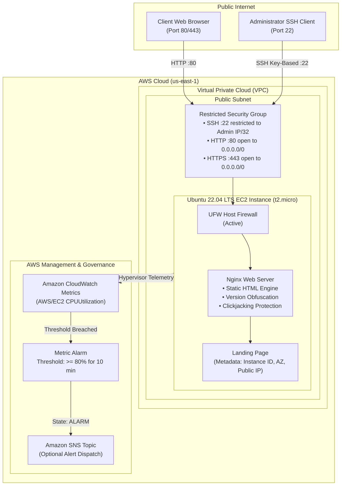

# Automated Web Server Deployment on AWS EC2

[](https://aws.amazon.com/)
[](https://ubuntu.com/)
[](https://nginx.org/)
[](https://ubuntu.com/server/docs/security-firewall)
[](https://www.gnu.org/software/bash/)
[](https://aws.amazon.com/cloudwatch/)

A production-grade infrastructure automation and cloud administration project demonstrating the hands-off provisioning, configuration, security hardening, and metric-based observability of a high-performance **Nginx** web server on an **AWS EC2 Ubuntu 22.04 LTS** instance.

The project incorporates AWS networking controls (custom VPC security groups with least-privilege CIDR blocks), key-based OpenSSH authentication, automated bash bootstrapping with Instance Metadata Service version 2 (IMDSv2) integration, host-level firewall enforcement via UFW, web application security headers, and automated CloudWatch alarms tracking CPU utilization thresholds.

---

## Table of Contents

- [Project Architecture](#project-architecture)
- [Key Engineering Features](#key-engineering-features)
- [Repository Structure](#repository-structure)
- [Network & Security Architecture](#network--security-architecture)
  - [Security Group Rules Matrix](#security-group-rules-matrix)
  - [Host-Level Hardening & Headers](#host-level-hardening--headers)
- [Step-by-Step Deployment Guide](#step-by-step-deployment-guide)
  - [Option A: 100% Automated Deployment via AWS CLI](#option-a-100-automated-deployment-via-aws-cli-recommended)
  - [Option B: AWS Management Console Manual Walkthrough](#option-b-aws-management-console-manual-walkthrough)
  - [Option C: EC2 User-Data Bootstrap Initialization](#option-c-ec2-user-data-bootstrap-initialization)
- [Amazon CloudWatch Alarm Configuration](#amazon-cloudwatch-alarm-configuration)
  - [Alarm Metric Specification](#alarm-metric-specification)
  - [SNS Topic & Notification Setup](#sns-topic--notification-setup)
- [Verification, Testing & Stress Simulation](#verification-testing--stress-simulation)
- [Production Runbook & Troubleshooting](#production-runbook--troubleshooting)
- [Teardown & Cost Optimization](#teardown--cost-optimization)

---

## Project Architecture



---

## Key Engineering Features

1. **Zero-Touch Automated Provisioning**:
   - `scripts/install_nginx.sh` executes end-to-end configuration without user prompts (`DEBIAN_FRONTEND=noninteractive`).
   - Packages are synchronized, upgraded with safe defaults (`force-confdef`, `force-confold`), and verified.
2. **Restricted Security Perimeter (Principle of Least Privilege)**:
   - AWS Security Group automatically resolves your current public IPv4 address (`https://checkip.amazonaws.com`) and bounds Port 22 SSH ingress exclusively to your `/32` CIDR block.
   - Brute-force attacks against SSH are mitigated at the AWS hypervisor perimeter before reaching the virtual instance.
3. **IMDSv2 Integration**:
   - Implements AWS Instance Metadata Service version 2 (token-based session headers) to safely query the instance ID, Availability Zone, and public IP address without exposing IMDSv1 vulnerabilities.
4. **Nginx Security & Performance Hardening**:
   - `server_tokens off;` prevents version banner disclosure to web scanners.
   - Security headers injected: `X-Frame-Options: SAMEORIGIN`, `X-Content-Type-Options: nosniff`, and `X-XSS-Protection: 1; mode=block`.
   - Timeout hardening against slowloris attacks (`client_body_timeout 12s`, `keepalive_timeout 15s`).
5. **Metric-Based Observability & Automated Alerting**:
   - CloudWatch Alarm tracks EC2 hypervisor-level CPU metric (`CPUUtilization`).
   - Prevents silent instance death and capacity exhaustion during traffic surges.

---

## Repository Structure

```
aws-ec2-webserver-deployment/
├── aws-cli/
│   └── launch_instance.sh         # Complete AWS CLI automated provisioning pipeline
├── scripts/
│   ├── install_nginx.sh           # One-run Nginx installer, hardening & dynamic page setup
│   ├── setup_cloudwatch_alarm.sh  # CloudWatch CPU alarm configuration script
│   └── user_data.sh               # Cloud-init bootstrap script for launch-time setup
├── .gitignore                     # Ignores sensitive keys (*.pem), logs, and terraform state
└── README.md                      # Comprehensive architecture and technical documentation
```

---

## Network & Security Architecture

### Security Group Rules Matrix

| Direction | Type | Protocol | Port Range | Source / Destination | Security Justification |
| :--- | :--- | :--- | :--- | :--- | :--- |
| **Inbound** | SSH | TCP | `22` | `<ADMIN_IP>/32` | Administrative shell access restricted to developer's network. Blocks public scanning. |
| **Inbound** | HTTP | TCP | `80` | `0.0.0.0/0` | Public web server port allowing HTTP traffic to reach Nginx. |
| **Inbound** | HTTPS | TCP | `443` | `0.0.0.0/0` | Secure web server port for SSL/TLS encrypted traffic. |
| **Outbound**| All Traffic | All | All | `0.0.0.0/0` | Permits OS package updates, security patches, and AWS API telemetry calls. |

### Host-Level Hardening & Headers

In addition to AWS Security Groups, host-level security is enforced on the Ubuntu instance:

1. **UFW (Uncomplicated Firewall)**:
   ```bash
   sudo ufw default deny incoming
   sudo ufw default allow outgoing
   sudo ufw allow OpenSSH
   sudo ufw allow 'Nginx Full'
   sudo ufw enable
   ```
2. **Nginx Security Configuration (`/etc/nginx/conf.d/security.conf`)**:
   ```nginx
   # Disable Nginx version in HTTP headers and default error pages
   server_tokens off;

   # Buffer size restrictions to mitigate memory exhaustion attacks
   client_body_buffer_size 10K;
   client_header_buffer_size 1k;
   client_max_body_size 8m;
   large_client_header_buffers 2 1k;

   # Request timeout constraints
   client_body_timeout 12;
   client_header_timeout 12;
   keepalive_timeout 15;
   send_timeout 10;

   # OWASP recommended security headers
   add_header X-Frame-Options "SAMEORIGIN" always;
   add_header X-Content-Type-Options "nosniff" always;
   add_header X-XSS-Protection "1; mode=block" always;
   ```

---

## Step-by-Step Deployment Guide

### Prerequisites
- An active AWS Account.
- [AWS CLI v2](https://docs.aws.amazon.com/cli/latest/userguide/install-cliv2.html) installed locally.
- Configured credentials with EC2 and CloudWatch administrative access:
  ```bash
  aws configure
  ```

---

### Option A: 100% Automated Deployment via AWS CLI (Recommended)

The provided script [`aws-cli/launch_instance.sh`](aws-cli/launch_instance.sh) executes all provisioning tasks in under two minutes:

```bash
# Clone the repository
git clone https://github.com/RudraliS/aws-ec2-webserver-deployment.git
cd aws-ec2-webserver-deployment

# Make scripts executable
chmod +x aws-cli/launch_instance.sh scripts/*.sh

# Run the automated launch script (default region: us-east-1)
./aws-cli/launch_instance.sh
```

**What the script executes under the hood:**
1. Queries the latest official Canonical Ubuntu 22.04 LTS AMI (`ubuntu-jammy-22.04-amd64-server-*`).
2. Detects your public IP and creates an AWS Key Pair (`ec2-webserver-key.pem`), securing file permissions to `chmod 400`.
3. Creates the restricted security group `webserver-restricted-sg` in your default VPC.
4. Authorizes Port 22 strictly for your IP and Port 80 for public access.
5. Launches the `t2.micro` EC2 instance and supplies [`scripts/user_data.sh`](scripts/user_data.sh) for zero-touch bootstrapping.
6. Waits for instance status checks to complete and prints the live web URL.

---

### Option B: AWS Management Console Manual Walkthrough

#### 1. Generate SSH Key Pair
1. Open the [EC2 Console](https://console.aws.amazon.com/ec2/).
2. Under **Network & Security**, click **Key Pairs** > **Create key pair**.
3. Name: `ec2-webserver-key` | Key pair type: **RSA** | Private key format: **.pem**.
4. Save the file and lock permissions:
   ```bash
   chmod 400 ec2-webserver-key.pem
   ```

#### 2. Configure Restricted Security Group
1. Under **Network & Security**, click **Security Groups** > **Create security group**.
2. **Name**: `webserver-restricted-sg` | **Description**: `Restricted SG for Web Server`.
3. **Inbound rules**:
   - `Type`: **SSH** | `Port`: `22` | `Source`: **My IP** (`<YOUR_IP>/32`).
   - `Type`: **HTTP** | `Port`: `80` | `Source`: **Anywhere-IPv4** (`0.0.0.0/0`).
   - `Type`: **HTTPS** | `Port`: `443` | `Source`: **Anywhere-IPv4** (`0.0.0.0/0`).
4. Click **Create security group**.

#### 3. Launch EC2 Instance
1. Click **Launch instances**.
2. **Name**: `Nginx-Automated-Server`.
3. **Application and OS Images**: **Ubuntu Server 22.04 LTS** (64-bit x86).
4. **Instance type**: `t2.micro` (Free Tier eligible).
5. **Key pair**: Select `ec2-webserver-key`.
6. **Network settings**: Click **Select existing security group** and choose `webserver-restricted-sg`.
7. **Advanced details > User data**: Paste the entire contents of [`scripts/user_data.sh`](scripts/user_data.sh).
8. Click **Launch instance**.

---

### Option C: EC2 User-Data Bootstrap Initialization

If provisioning via Terraform, CloudFormation, or CLI manually, attach [`scripts/user_data.sh`](scripts/user_data.sh) directly to the launch template:

```bash
aws ec2 run-instances \
    --image-id ami-0c7217cdde317cfec \
    --instance-type t2.micro \
    --key-name ec2-webserver-key \
    --security-group-ids sg-0123456789abcdef0 \
    --user-data file://scripts/user_data.sh \
    --region us-east-1
```

The bootstrap logs are preserved for inspection on the server at `/var/log/user-data.log`.

---

## Amazon CloudWatch Alarm Configuration

To safeguard against Denial of Service (DoS) attacks, memory leak thrashing, or application runaways, a CloudWatch Alarm monitors average CPU consumption.

### Alarm Metric Specification

| Parameter | Configuration Value | Description |
| :--- | :--- | :--- |
| **Namespace** | `AWS/EC2` | AWS hypervisor metric store |
| **MetricName** | `CPUUtilization` | Percentage of allocated compute units consumed |
| **Statistic** | `Average` | Average across computation interval |
| **Period** | `300` (5 minutes) | Sampling bucket width |
| **Evaluation Periods** | `2` consecutive datapoints | Must breach for 10 continuous minutes before firing |
| **Threshold** | `80.0%` | Alarm threshold trigger |
| **Comparison Operator**| `GreaterThanOrEqualToThreshold`| Trigger condition |
| **TreatMissingData** | `notBreaching` | Prevents false alerts on newly spawned instances |

### Automated Alarm Creation Script

Run the automated script locally or directly inside the EC2 instance:

```bash
chmod +x scripts/setup_cloudwatch_alarm.sh
./scripts/setup_cloudwatch_alarm.sh <INSTANCE_ID> [AWS_REGION] [OPTIONAL_SNS_TOPIC_ARN]
```

### AWS CLI Direct Command

```bash
aws cloudwatch put-metric-alarm \
    --alarm-name "EC2-High-CPU-Utilization-<INSTANCE_ID>" \
    --alarm-description "Triggers when EC2 instance average CPU exceeds 80% for 10 minutes" \
    --metric-name CPUUtilization \
    --namespace AWS/EC2 \
    --statistic Average \
    --period 300 \
    --evaluation-periods 2 \
    --threshold 80 \
    --comparison-operator GreaterThanOrEqualToThreshold \
    --dimensions Name=InstanceId,Value=<INSTANCE_ID> \
    --region us-east-1
```

---

## Verification, Testing & Stress Simulation

### 1. HTTP Endpoint & Web Server Validation
Open your browser and navigate to:
```
http://<EC2_PUBLIC_IP>
```
Verify that the custom landing page displays the active status, Instance ID, and Availability Zone.

Verify HTTP headers via `curl`:
```bash
curl -I http://<EC2_PUBLIC_IP>
```
Expected output showing security headers:
```http
HTTP/1.1 200 OK
Server: nginx
Date: Wed, 05 Nov 2026 03:00:00 GMT
Content-Type: text/html
Connection: keep-alive
X-Frame-Options: SAMEORIGIN
X-Content-Type-Options: nosniff
X-XSS-Protection: 1; mode=block
```
*(Notice that the Nginx version number is completely hidden).*

### 2. Verify Service State via SSH
```bash
ssh -i ec2-webserver-key.pem ubuntu@<EC2_PUBLIC_IP>

# Check service status
sudo systemctl status nginx --no-pager

# Check firewall rules
sudo ufw status verbose
```

### 3. Stress Test & Alarm Trigger Simulation
Simulate a heavy CPU spike to verify that the CloudWatch alarm transitions to the **ALARM** state:

```bash
# SSH into the EC2 instance
ssh -i ec2-webserver-key.pem ubuntu@<EC2_PUBLIC_IP>

# Install the stress testing package
sudo apt-get update && sudo apt-get install -y stress

# Saturate 2 CPU cores for 12 minutes (720 seconds)
stress --cpu 2 --timeout 720s
```

Monitor the alarm state in real time:
```bash
aws cloudwatch describe-alarms \
    --alarm-names "EC2-High-CPU-Utilization-<INSTANCE_ID>" \
    --query "MetricAlarms[*].[AlarmName,StateValue,StateReason]" \
    --output table
```
After 10 minutes, the alarm status will transition from `OK` to `ALARM`.

---

## Production Runbook & Troubleshooting

| Symptom / Error | Root Cause | Diagnostic Command | Remediation Action |
| :--- | :--- | :--- | :--- |
| **SSH Connection Timed Out** | Security group Port 22 does not match your current IP. | `curl -s https://checkip.amazonaws.com` | Update the SG rule with your current `/32` IP address. |
| **HTTP Request Connection Refused** | Nginx service stopped or UFW blocking port 80. | `sudo systemctl status nginx` / `sudo ufw status` | Run `sudo systemctl restart nginx` and `sudo ufw allow 'Nginx Full'`. |
| **502 Bad Gateway** | Misconfigured upstream proxy (if configured). | `sudo tail -n 50 /var/log/nginx/error.log` | Inspect upstream process binding on port 127.0.0.1. |
| **Permission Denied (publickey)** | Wrong key pair or incorrect file permissions on `.pem`. | `ls -la ec2-webserver-key.pem` | Ensure file permissions are set to `chmod 400 ec2-webserver-key.pem`. Connect as user `ubuntu`. |
| **User Data did not run** | Syntax error in script or cloud-init failure. | `sudo cat /var/log/cloud-init-output.log` | Review execution logs in `/var/log/user-data.log`. |

---

## Teardown & Cost Optimization

To prevent unintentional charges against your AWS monthly billing:

```bash
# 1. Terminate the EC2 Instance
aws ec2 terminate-instances --instance-ids <INSTANCE_ID> --region us-east-1

# 2. Delete the CloudWatch Alarm
aws cloudwatch delete-alarms --alarm-names "EC2-High-CPU-Utilization-<INSTANCE_ID>" --region us-east-1

# 3. Delete Security Group (after instance termination completes)
aws ec2 delete-security-group --group-id <SECURITY_GROUP_ID> --region us-east-1

# 4. Delete the Key Pair
aws ec2 delete-key-pair --key-name ec2-webserver-key --region us-east-1
rm -f ec2-webserver-key.pem
```
